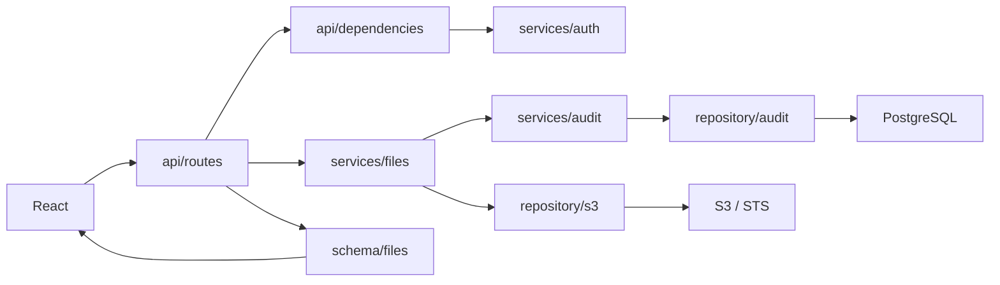

# FastAPI katman mimarisi

Backend, görseldeki `api / core / model / repository / schema / services / util` düzenini kullanır. Bütün Python paketleri `backend/app/` altında bulunur. Klasör adları sorumlulukları gösterir; eski düz modüllerin kopyaları tutulmaz.

```text
backend/
├── app/
│   ├── main.py                 # Uygulama factory'si: parçaları bağlar
│   ├── api/
│   │   ├── router.py           # Router'ları bir araya getirir
│   │   ├── dependencies.py     # Her isteğin servislerini oluşturur, kimliği doğrulatır
│   │   ├── middleware.py       # Request ID, güvenlik başlıkları, güvenli log
│   │   ├── errors.py           # Uygulama hatalarını HTTP/Pydantic cevaplarına çevirir
│   │   └── routes/
│   │       ├── auth.py         # Login, logout, /me
│   │       ├── files.py        # Liste, önizleme, streaming download
│   │       └── health.py       # Liveness ve readiness
│   ├── core/
│   │   ├── config.py          # Pydantic Settings
│   │   ├── database.py        # Engine ve session factory
│   │   ├── resources.py       # Havuzların kurulması, sahipliği ve kapanması
│   │   ├── security.py        # HMAC ve rastgele anahtar/oturum yardımcıları
│   │   └── errors.py          # Framework'ten bağımsız ServiceError / ErrorKind
│   ├── model/
│   │   ├── base.py            # Ortak SQLAlchemy Base
│   │   ├── customer.py        # Müşteri tablosu
│   │   ├── api_key.py         # API key tablosu
│   │   ├── audit_event.py     # Audit tablosu
│   │   └── principal.py       # Doğrulanmış müşteri ve anahtar bağlamı
│   ├── repository/
│   │   ├── customers.py       # Müşteri sorguları ve PostgreSQL kayıt kilidi
│   │   ├── api_keys.py        # Anahtar sorguları
│   │   ├── audit.py           # Audit kaydını session'a ekler
│   │   ├── sessions.py        # Redis oturum işlemleri ve atomik sayaç
│   │   ├── s3.py              # STS, S3, prefix/cursor ve sınırlı bayt okuma
│   │   └── health.py          # Veritabanına erişim kontrolü
│   ├── schema/
│   │   ├── base.py            # Ortak Pydantic çıktı kuralları
│   │   ├── auth.py            # LoginRequest, LoginResponse, MeResponse
│   │   ├── customer.py        # Müşteriye açık ID/ad
│   │   ├── files.py           # Liste ve CSV cevapları
│   │   ├── health.py          # Sağlık cevapları
│   │   └── error.py           # Güvenli hata cevabı
│   ├── services/
│   │   ├── auth.py            # Anahtar geçerliliği, oturum, revoke/expiry kontrolü
│   │   ├── admin.py           # Müşteri kaydı, prefix çakışması, anahtar yönetimi
│   │   ├── files.py           # Dosya işlemleri ve audit gereksinimi
│   │   ├── csv_preview.py     # CSV biçimi, satır/sütun limitleri
│   │   ├── audit.py           # HTTP audit kaydını kalıcılaştırır
│   │   ├── rate_limit.py      # Sayaç sonucuna göre hız sınırı kararı
│   │   └── health.py          # Readiness kararı
│   ├── util/
│   │   ├── paths.py           # Güvenli göreli yol ve prefix birleştirme
│   │   └── time.py            # UTC zaman yardımcısı
│   ├── cli.py                 # Operatör komutları, transaction ve çıktı
│   └── demo.py                # Yalnızca yerel demo verisi
├── migrations/                # Alembic: sürümlü veritabanı şeması
└── tests/                     # HTTP, servis, mimari ve gerçek servis testleri
```

Her klasörde `__init__.py` bulunur. `from app.services.files import FileService`, Python'a `app` paketi içindeki `services/files.py` modülünden bu sınıfı yüklemesini söyler. `model/__init__.py` bütün tablo sınıflarını import eder; Alembic bu sayede yalnızca bir kısmını görüp yanlış migration üretmez.

## Bir isteğin izlediği yol



Örneğin kullanıcı `GET /api/files/preview?path=2026/09/berlin_solar/production.csv` ister:

1. Middleware istek ID'si oluşturur. `api/dependencies.py` uygulama kaynaklarından bu isteğe ait servisleri kurar.
2. `Auth` dependency'si anahtarı/oturumu `AuthService` ile doğrular. Müşteri bilgisi DB'den gelir; query parametresinden gelmez. Origin ve cookie kuralları HTTP katmanında kontrol edilir.
3. Router, yalnızca doğrulanmış `Principal` ve göreli yolu `FileService.preview()` metoduna verir.
4. Servis CSV türünü kontrol eder. S3 repository müşterinin kayıtlı bucket/prefix/rolünü kullanarak ETag koşullu ve boyut sınırına tabi okuma yapar. CSV parser satır/sütun kurallarını uygular.
5. Audit kaydı kalıcılaşır. Router'ın `response_model=CsvPreviewResponse` tanımı çıktıyı doğrular ve müşteriye açık alanları JSON olarak gönderir.

`main.py` bu adımların iş mantığını içermez: ayarları alır, kaynakları bağlar, middleware/hata handler'larını kurar ve `include_router()` çağırır. Router'ların ayrı modüllerde kullanımı FastAPI'nin [çok dosyalı uygulama mekanizmasına](https://fastapi.tiangolo.com/tutorial/bigger-applications/) dayanır. Buradaki katman seçimi projenin bakım ve öğretim ihtiyaçlarına göre yapılmıştır; FastAPI'nin zorunlu tuttuğu tek bir klasör düzeni değildir.

## Router, service ve repository neden ayrı?

Router HTTP'yi bilir: `Query`, `Request`, `Response`, cookie, status code ve streaming burada anlamlıdır. Dosya listesi endpoint'inin işi kısadır:

```python
@router.get("", response_model=FilePageResponse)
def files(principal: Auth, service: FileServiceDep, ...):
    return service.list(principal, path, cursor, limit)
```

Servis iş sırasını bilir. `FileService.list()` listeyi repository'den alır, audit'i kaydeder ve sonucu döndürür. `AdminService` bir bucket/prefix'in başka müşteriyle çakışıp çakışmadığına karar verir. Bu kurallar FastAPI `Request` nesnesi gerektirmez; yönetim komutu veya doğrudan servis testi de aynı kodu çağırabilir.

Repository verinin nasıl okunduğunu/yazıldığını bilir. SQL sorguları SQLAlchemy repository'lerindedir; Redis Lua/pipeline komutları `sessions.py`, AWS çağrıları `s3.py` içindedir. `S3Repository`, müşteri kapsamını bilerek tekrar uygular; veriye en yakın katmanda tenant sınırını korur.

Servis ve repository'ler FastAPI/Starlette import etmez. `ServiceError(ErrorKind.NOT_FOUND, ...)` üretirler; `api/errors.py` bunu 404'e çevirir. Böylece CSV veya S3 kodu bir HTTP response oluşturmaz. `core/resources.py`, uygulama ömürlü havuzları kurduğu için repository sınıfını import eder; `api/dependencies.py` de istek ömürlü servisleri birleştirir. Bu iki dosya bağımlılıkların kurulduğu yerlerdir.

## Model ve schema farklı görevler yapar

`model/customer.py`, sakladığımız tabloyu tanımlar: bucket/prefix ve IAM rolü dahildir. `schema/customer.py`, müşteriye dönecek JSON'u tanımlar: yalnızca `id`, `name`. SQLAlchemy modeli veri saklama, Pydantic modeli API doğrulama ve serileştirme içindir. İşlemlerin Pydantic kısmı [öğrenme rehberinde](OGRENME_REHBERI.md#4a-pydantic-gelen-ve-giden-verinin-sözleşmesi) örneklerle anlatılır.

Bu uygulamada servisler SQLAlchemy model nesnelerini kullanır. Ayrı domain entity/mapper katmanı eklenmedi. Uygulama ölçeği büyüyüp aynı domain farklı veri depolarında çalışacaksa bu ayrım değerlendirilebilir; mevcut yapı somut katmanlı mimaridir.

## Transaction ve kaynak ömrü

SQLAlchemy Engine ve Redis/S3 havuzları uygulama ömürlüdür. SQLAlchemy `Session` ise istek ömürlüdür. `Depends(get_db)` aynı HTTP isteğinde aynı session'ı servislerle paylaşır; sonraki istek yeni session alır. Bağlantı ve session sahipliğini ayrı tutma yaklaşımı [SQLAlchemy session rehberiyle](https://docs.sqlalchemy.org/en/20/orm/session_basics.html) uyumludur.

Repository `add()` veya `flush()` yapabilir, **commit yapmaz**. `flush`, SQL'i transaction içinde DB'ye yollar; işlemi kalıcı olarak tamamlamaz. Operatör komutu `with factory.begin()` içinde müşteri/anahtar/audit işlemlerini birlikte yürütür; hata olursa hepsi rollback olur. API'nin korunan dosya işlemleri salt okunurdur; `AuditService` audit'i commit etmeden veri teslim edilmez. Audit başarısızsa açılmış download stream'i servis tarafından kapatılır.

S3 istemcilerinin cache'i müşteri ID, bucket, prefix, rol ve external ID gibi yetki bilgilerine bağlıdır. Global bir customer veya request `Session` saklanmaz. `Resources.close()` uygulamanın oluşturduğu kaynakları bırakır; testin dışarıdan verdiği kaynakları kapatmaz. `lifespan` kapanış sırasında bu temizliği çalıştırır. [FastAPI lifespan açıklaması](https://fastapi.tiangolo.com/advanced/events/).

## Nasıl korunuyor ve nasıl genişletilir?

`test_architecture.py`, servis/repository katmanlarının HTTP katmanına import ile bağlanmasını ve repository'lerin commit yapmasını reddeder. İki ayrı uygulama factory'sinin ayarları birbirine karışmadığı da test edilir. `test_admin_service.py` transaction rollback, anahtar iptali ve müşteri devre dışı bırakmayı sınar. HTTP izolasyon ve Pydantic sözleşme testleri de çalışmaya devam eder.

Yeni bir işlev için önce servis davranışını ve gerekli repository işlemini tanımlayın; API'ye açılacak alanları `schema/` içinde belirtin ve küçük bir router endpoint'i ekleyin. Ardından yetkilendirme, hata ve transaction senaryolarını test edin. `util/` yalnızca küçük ortak yardımcılar içindir; iş kurallarını oraya taşımayın.

Mevcut URL'ler, JSON alanları ve `python -m app.cli` / `app.main:create_app` giriş noktaları korunur. Veritabanı tabloları değişmediğinden yeni migration gerekmez. Dağıtımda yeni image kullanılır; eski modülleri hedefleyen özel Python importları yeni dosya yollarına taşınmalıdır.
