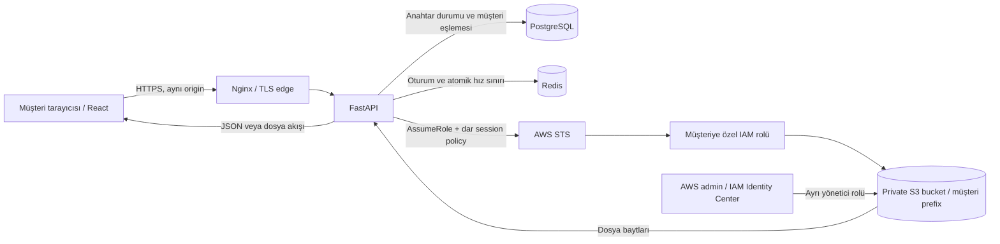

# Mimari ve güvenlik sınırları

Backend'in paket yapısı, katman görevleri, dependency injection ve transaction sınırları [FastAPI mimarisi rehberinde](FASTAPI_MIMARISI.md) açıklanır. `main.py` uygulamayı kurar; router → service → repository akışı müşteri kapsamını korur.

## İstek akışı

Uygulamada sadece okuma vardır. Yükleme/silme endpoint'i, AWS console login'i, S3 presigned URL veya tarayıcıya verilen AWS credential yoktur. Tüm dosya aktarımı uygulamanın origin'inden geçer. AWS admin yetkiniz uygulama müşteri yetkisinden ayrıdır.

## Kimlik, yetki ve oturum ayrı kavramlar

- **Kimlik doğrulama:** bu API key doğru, süresi dolmamış ve iptal edilmemiş mi?
- **Yetkilendirme:** bu doğrulanmış anahtar hangi müşteri ve hangi bucket/prefix için geçerli?
- **Oturum:** tarayıcı sonraki istekte ham API key taşımadan aynı anahtarı nasıl temsil eder?

Browser bir müşteriden diğerine geçmek için farklı geçerli anahtarla oturum açmalıdır. Query/header/body üzerinden `customer_id`, `bucket` veya `role_arn` değiştirmek kapsamı değiştirmez.

## İki depolama modeli

| Model | DB eşlemesi | Özellik |
|---|---|---|
| Ortak bucket, ayrı klasör | `bucket=shared`, `prefix=amy_c001/` | Çok sayıda müşteri için daha az bucket yönetimi |
| Müşteri başına bucket | `bucket=amy-private`, `prefix=""` | Bucket policy, lifecycle, region gibi ayarlar bağımsızlaştırılabilir |

Bu sürüm tek müşteri kaydına tek bucket/prefix atar. Aynı müşterinin birden fazla bağımsız bucket'ı gerekirse `storage_locations` gibi ayrı tablo ve yetkili location ID eklenmelidir; doğrudan istemciden bucket parametresi kabul edilmemelidir. Ortak region ayarı kullanılır; çok region senaryosunda region da storage kaydına taşınmalıdır.

`add_customer()` aynı bucket'ta eşit, üst veya alt prefix çakışmasını reddeder. PostgreSQL advisory transaction lock, iki eşzamanlı kayıt işlemini sıralar. Dev SQLite ortamı için bu eşzamanlılık garantisi verilmez. DB'ye doğrudan elle yazmak bu kontrolü atlar; yönetim CLI'si veya aynı kontrolü kullanan migration kullanılmalıdır. Pasif müşterinin alanı da başka müşteriye yeniden tahsis edilmez.

## Tehdit modeli

| Tehdit | Kontrol | Test / sınır |
|---|---|---|
| Başka müşteri dosyasını istemek (IDOR) | Bucket/prefix yalnızca doğrulanmış DB kaydından | İki prefix ve özel bucket testleri |
| `../`, çift kodlama, ters slash | Katı göreli yol doğrulaması; normalize etmeden ret | Parametrik üç endpoint testleri |
| `amy` ile `amy2` prefix karışması | Müşteri prefix'i `/` ile biter | Komşu prefix testi |
| Başka müşteri sayfa token'ını kullanmak | Süreli imza + müşteri/bucket/tam prefix bağı | Sayfa kapsamı ve imza değiştirme testleri |
| API anahtarının DB'den çalınması | DB'de HMAC özeti; ayrı APP_SECRET | Ham key depolanmaz |
| Brute force / çok sayıda API isteği | Nginx login limiti + Redis atomik IP/müşteri sayaçları | 429/Retry-After, gerçek Redis paralel testi |
| CSRF ve login CSRF | Login/logout'ta tam Origin kontrolü; Strict cookie; CORS yok | Yanlış/eksik Origin reddi |
| CSV hücresinden XSS | React metin kaçışı, CSP, HTML injection yok | Zararlı hücre testte metin olarak görünür |
| Çok büyük CSV/bellek tüketimi | Bayt/satır/sütun sınırları; timeout | 413/422, satır kesme testleri |
| HEAD/GET arasında değişen nesne | ETag `IfMatch` ve tekrar boyut sınırı | 409 testi |
| İptal sonrası açık session | Her istekte key ve customer aktiflik kontrolü | Açık cookie ile revoke/expire/disable testleri |
| Redis kesintisinde kontrol atlama | Fail closed, 503 | Redis hata testi |
| AWS hata detaylarından bilgi sızıntısı | Kullanıcıya genel 404/409/503 | Bucket ismi response'a yazılmaz |
| Tehlikeli dosyanın aynı origin'de açılması | Attachment + octet-stream + nosniff | Download header testi |

## Güvenilen taraflar ve sınırlar

Müşteri isteği güvenilmez. Backend kodu, DB eşlemeleri, admin CLI ortamı ve IAM tanımları güvenilen bileşenlerdir. Bu mimari ele geçirilmiş bir backend yöneticisinin veya kötü niyetli AWS admin'in bütün müşterilere erişmesini engellemez. Uygulama rolü birden çok müşteri rolünü üstlenebildiğinden, backend tamamen ele geçirilirse müşteri verileri risk altındadır. Daha katı izolasyon için müşteri başına ayrı hesap/servis/workload tasarlanabilir.

AWS politikasının güvenliği yalnızca bu depodaki `Allow` satırlarına bağlı değildir: bucket policy, KMS key policy, permissions boundary, SCP ve mevcut rol izinleri de etkilidir. Müşteri rollerine/bare session ARN'lerine geniş kaynak politikası izinleri verilmemelidir. [AWS IAM değerlendirme mantığı](https://docs.aws.amazon.com/IAM/latest/UserGuide/reference_policies_evaluation-logic.html).

API key bir bearer sırdır: bilen kişi kullanabilir. Kullanıcının cihazından veya iletim kanalından çalınan geçerli key'i bu uygulama ayırt edemez. Anahtarlar parola yöneticisi/güvenli kanal ile kişiye özel teslim edilmelidir. Yüksek güvence gereksiniminde OIDC/SSO + MFA kimlik doğrulaması ayrı bir genişletmedir.

## Dosya ve CSV sözleşmesi

- Görünen liste tek seferde en fazla 200 öğe getirir; klasörler ve dosyalar toplamı S3 sayfasına tabidir. Ekrandaki sayılar tüm bucket istatistiği değildir, yüklenen sayfaları gösterir.
- Sayfa token'ı 15 dakika geçerlidir ve oturum sırrından ayrı salt ile imzalanır. İçeriği şifrelenmez; AWS credential içermez. Key/prefix bilgisi sayfalama verisinin içinde bulunabileceğinden token'ı gizlilik sağlayan bir kapsül olarak düşünmeyin.
- Dosya adları UTF-8 olabilir; güvenlik için `%`, kontrol karakteri, `\\`, `*`, `?`, `$`, `{`, `}`, boş segment, `.` ve `..` içeren key'ler desteklenmez. Listeleme bu nesneleri atlar.
- CSV UTF-8/BOM destekler; virgül, noktalı virgül, tab ve `|` ayracı algılanır. Algılama kesin değildir; karışık biçimler 422 alabilir. Tek başlık satırı beklenir.
- Önizleme en fazla 5 MiB, 200 satır, 100 sütun; Python CSV parser'ın hücre limiti de geçerlidir. Tüm dosyayı içe aktarma/doğrulama özelliği değildir.
- İndirme orijinal dosya baytlarını değiştirmez. Excel'de formül olarak yorumlanabilecek CSV hücreleri sanitize edilmez; portal önizlemesinde sadece metindir. Veri üreticisi spreadsheet formula injection riskini çıktı üretirken ayrıca yönetmelidir.
- Tam dosya indirme desteklenir. Range/resume, upload, delete, recursive global arama ve ZIP toplu indirme bu sürümün kapsamı değildir.

## Log ve audit

İstek logu yalnızca request ID, route şablonu, HTTP yöntemi, durum ve ilk yanıt süresini içerir. Bu süre bütün streaming download'ın süresi değildir. Authorization/header/cookie/body/query loglanmaz. Başarılı dosya işlemleri ve login denemeleri audit tablosunda tutulur. Hatalı dosya istekleri HTTP logunda durum koduyla görünür; bu sürüm bunların hepsini aktörlü audit kaydı olarak saklamaz.

`files.download_authorized` dosya aktarımının başlatılmasına izin verildiğini söyler; dosyanın kullanıcı diskine eksiksiz kaydedildiğini kanıtlamaz. Audit yazılamazsa korunan dosya işlemi fail closed olur. PostgreSQL erişimi olan ayrı operatörler audit tablosunu değiştirebilir; değiştirilemez kayıt ihtiyacında merkezi log deposu, CloudTrail S3 data event'leri ve Object Lock gibi ayrı mekanizmalar gerekir.

## Neden presigned URL seçmedik?

Presigned URL, büyük indirmelerde backend ağ maliyetini azaltabilir. Bu projede kullanıcıya AWS URL'si vermemek ve dosya erişimini uygulama üzerinden tutmak istendiği için proxy streaming seçildi. Bedeli backend çıkış trafiği, uzun bağlantılar ve kapasite ihtiyacıdır. Key iptali başladıktan sonra devam eden akışı otomatik geri çekmez.
